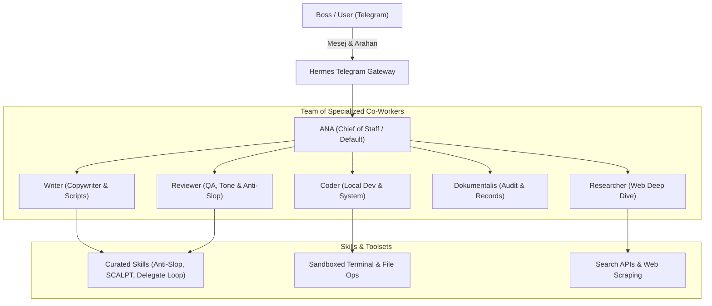

# 🧠 ANA Hermes Core (`ana-hermes-core`)

> **Autonomous Multi-Agent Orchestrator & Autonomous Workforce Engine**  
> Dicipta & Dibangunkan oleh: **Khairul Shafiq (Matrol)**  
> Edisi: *Production-Ready Turn-Key Distribution*

---

## 🌟 Ringkasan Ekosistem & Seni Bina Sistem

**ANA Hermes Core** ialah arkitektur ejen pintar autonomi hibrid yang berasaskan asas enjin **Hermes Agent**. Sistem ini direka khas untuk bertindak sebagai **"Otak & Penyelaras Eksekutif (The Mind & Chief of Staff)"** bagi mengendalikan pelbagai tugas berbilang ejen (*multi-agent co-workers*), integrasi Telegram 24/7, saluran kandungan automatik, penyelidikan mendalam, dan automasi sistem.



---

## 👥 Pasukan Ejen Terbina Dalam (*Co-Worker Personas*)

Di dalam folder `personas/`, sistem ini didatangkan dengan 6 profil watak teras:

| Profil Ejen | Nama Kod | Peranan & Tanggungjawab |
| :--- | :--- | :--- |
| **ANA (Chief of Staff)** | `default` | Orkestrator utama, penyelaras aliran kerja, pembuat keputusan strategik. |
| **Writer** | `writer` | Menulis skrip video TikTok/Reels, modul, artikel blog panjang, dan copywriting. |
| **Reviewer** | `reviewer` | Penilai kualiti (Hook, SEO, Tone Persona), memastikan kualiti anti-slop >= 8/10. |
| **Coder** | `coder` | Jurutera perisian tempatan untuk skrip automasi pantas dan DevOps. |
| **Dokumentalis** | `dokumentalis` | Pengarkib, pengurusan minit, rekod memori kekal, dan sistem fail. |
| **Researcher** | `researcher` | Penyelidikan web mendalam, perbandingan data, dan pengesahan fakta. |

---

## 🛠️ Kemahiran & Toolsets (*Skills Library*)

Direktori `skills/` mengandungi koleksi kemahiran bertaraf agensi:
* **`SKILL_humanizer_anti_slop.md`**: Enjin penapisan tulisan robotik untuk memastikan kandungan berbunyi tulen dan manusiawi.
* **`SKILL_delegate_verify_loop.md`**: Kitaran delegasi tugas antara ejen dengan pengesahan kendiri (*closed-loop validation*).
* **`SCALPT_framework.md`**: Kerangka kerja prompt berstruktur tinggi.
* **`curated-hermes-skills/`**: Koleksi modul sokongan (DevOps, Media, Productivity, GitHub, Social Media, dsb).

---

## 🚀 Panduan Pantas Pasang & Guna di VPS Baharu

Untuk menjalankan sistem ini pada mana-mana VPS baharu (Ubuntu 22.04 / 24.04 disyorkan):

### Langkah 1: Klon Repositori
```bash
git clone https://github.com/khairulxshafiq/ana-hermes-core.git
cd ana-hermes-core
```

### Langkah 2: Jalankan Skrip Pemasangan Automatik
```bash
chmod +x setup.sh
./setup.sh
```

### Langkah 3: Masukkan API Keys Anda
Buka fail konfigurasi persekitaran:
```bash
nano ~/.hermes/.env
```
Isikan kunci anda:
```env
TELEGRAM_BOT_TOKEN=token_bot_anda_di_sini
TELEGRAM_HOME_CHAT_ID=chat_id_telegram_anda
GEMINI_API_KEY_PAID=kunci_gemini_anda
```

### Langkah 4: Hidupkan Enjin Ejen
Untuk uji cuba di skrin terminal:
```bash
hermes gateway run
```
Atau aktifkan servis latar belakang 24/7 (*systemd*):
```bash
systemctl --user enable --now hermes-gateway
```

Semak log bot:
```bash
journalctl --user -u hermes-gateway -f
```

---

## 🔒 Keselamatan & Privasi
* Semua kunci API dan token sensitif diasingkan 100% ke dalam `.env` dan tidak disimpan di dalam repositori kod awam.
* Sesuai digandingkan dengan perkhidmatan awan (Tencent Cloud, GCP, AWS) mahupun pelayan persendirian.

---
*Dikuasakan oleh ekosistem ANA & TanAir Cloud.*
