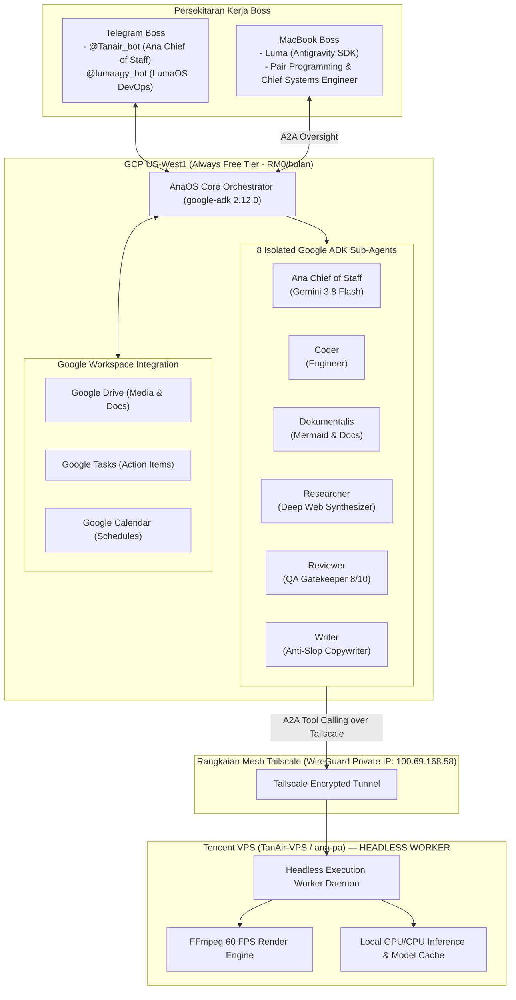

# BLUEPRINT INDUK MIGRASI: HERMES TANAIR-VPS KE GOOGLE ADK (AnaOS)
**Dokumen:** `HERMES_TO_GOOGLE_ADK_BLUEPRINT.md`  
**Tarikh:** 19 Oktober 2026  
**Status Audit:** 100% Selesai Dituai (Read-Only) dari Tencent TanAir-VPS (`ana-pa`)  
**Lokasi Simpanan Dossier Tempatan:** `/Users/khairulshafiq/Local-Luma/ana-migration-dossier/`  
**Arkitek:** Principal Multi-Agent Systems Architect (Luma on Mac)  

---

## 1. EKSEKUTIF RINGKASAN & MATLAMAT SENI BINA


### 1.1 Matlamat Strategik & Pemisahan Kuasa (Separation of Concerns)



---

## 2. PENGHAPUSAN "CONTEXT BLOAT & ATTENTION COLLAPSE"

### 2.1 Masalah Kritikal dalam Sistem Monolitik Lama (Hermes Monolith)
Dalam implementasi lama di `ana-pa`, apabila profil Ana memanggil fungsi atau memproses dokumen:
1. **Context Bloat:** Puluhan fail kemahiran (35+ kemahiran), log pangkalan data, dan arahan watak disumbat serentak ke dalam tetingkap konteks (*context window*).
2. **Attention Collapse:** Model mula berhalusinasi, mencampuradukkan persona (cth: jawapan teknikal kod bercampur gaya santai/manja), dan mengabaikan kekangan keselamatan penting.
3. **Pembaziran Kuota & Token:** Beribu-ribu token terbuang setiap kali menghantar mesej semakan kecil kerana keseluruhan sistem prompt perlu dimuatkan semula.

### 2.2 Penyelesaian Google ADK: Pengasingan Sempadan Sub-Ejen (Sandboxed Sub-agents)
Di bawah **Google ADK (`google-adk`)**, setiap ejen hanya mempunyai **satu tanggungjawab tunggal (*Single Responsibility Principle*)** dengan skop *tools* dan konteks yang terpencil:

| Sub-Ejen ADK | Persona & Teras | Fail Konfigurasi Asal | Model Google Disyorkan | Skop Alat & Kemahiran Terpencil (*Scoped Tools*) |
| :--- | :--- | :--- | :--- | :--- |
| **1. Ana (Chief of Staff)** | PA pintar, nakal, manja, cergas, pengatur swarm & penjaga Human-in-the-Loop (HITL). | `SOUL_default_ana_chief_of_staff.md` | `gemini-3.8-flash` | Telegram Gateway, Sub-agent Router, Kanban Approval, Google Tasks, Calendar Dispatch. |
| **3. Coder** | Jurutera perisian sistem, refactoring, audit kod, integrasi API, pengesahan sintaks. | `SOUL_coder.md` | `gemini-4-argon` / `gemini-3.8-flash` | Shell Execution, Git Ops, Code Linter, Container/Process Lifecycle, Tailscale Mesh Ping. |
| **5. Dokumentalis** | Arkitek arkib & dokumentasi, lukisan rajah visual arkitektur (Mermaid), penulisan fail Markdown. | `SOUL_dokumentalis.md` | `gemini-3.8-flash` | Mermaid Generator, Markdown Spec Compiler, File Archiver, Repo Cataloger. |
| **6. Researcher** | Penyelidik web mendalam, pemantau berita industri, analisis pesaing & sintesis fakta. | `SOUL_researcher.md` | `gemini-3.8-flash` | Google Search Tool, Web Scraping Engine, Competitor News Fetcher, Sentiment Analyzer. |
| **7. Reviewer** | Pegawai Kawalan Kualiti (QA Gatekeeper), penilai rubrik ketat (1-10), pengesah keselamatan kod/kandungan. | `SOUL_reviewer.md` | `gemini-4-argon` | Rubric Evaluator (>=8/10 gate), Anti-Slop Verifier, Diff Reviewer, Safety Policy Checker. |
| **8. Writer** | Penulis salinan (*Copywriter*) & naratif panjang, bahasa Melayu natural bebas klise (*anti-slop*). | `SOUL_writer.md` | `gemini-3.8-flash` | Anti-Slop Humanizer, Headline Crafter, Social Post Builder, Blog Formatter. |

---

## 3. RANGKA KERJA PIPELINE GOOGLE ADK

Google ADK menyediakan kelas orkestrasi asli (`SequentialAgent`, `ParallelAgent`, `LoopAgent`) yang menghapuskan keperluan skrip bash manual (*fragile cron scripts*):

### 3.1 Pipeline Naratif & Penerbitan Kandungan (`SequentialAgent`)
Memastikan aliran kerja berperingkat berjalan dengan kawalan mutu terjamin:
```python
from google.adk.agents import SequentialAgent

content_pipeline = SequentialAgent(
    name="ContentPublishingPipeline",
    subagents=[
        researcher_agent,   # 1. Kaji topik & kumpul fakta
        writer_agent,       # 2. Karang draf artikel/pos menggunakan formula anti-slop
        reviewer_agent      # 3. Semak rubrik kualiti (mesti >= 8/10 sebelum status READY)
    ]
)
```

### 3.2 Pipeline Imbasan Pasaran & Pesaing (`ParallelAgent`)
Menjalankan analisis pasaran serentak untuk menjimatkan masa pemprosesan:
```python
from google.adk.agents import ParallelAgent

market_intelligence_pipeline = ParallelAgent(
    name="MarketIntelligencePipeline",
    subagents=[
        researcher_agent    # Imbas sentimen berita & laporan kewangan terkini
    ]
)
```

### 3.3 LoopAgent untuk Kejuruteraan & Pembetulan Kendiri (`LoopAgent`)
Memastikan sebarang tugasan kod disahkan dengan ujian sebelum diluluskan:
```python
from google.adk.agents import LoopAgent

code_refactor_loop = LoopAgent(
    name="CodeSelfHealingLoop",
    agent=coder_agent,
    validator_agent=reviewer_agent,
    max_iterations=3,
    exit_condition=lambda result: result.get("tests_passed", False) is True
)
```

---

## 4. INTEGRASI ASLI GOOGLE WORKSPACE

Memandangkan AnaOS dihoskan di bawah ekosistem Google (GCP & Google ADK), integrasi dengan Google Workspace dijalankan secara asli melalui Google APIs rasmi:

1. **Google Drive:**
   - Menyimpan semua artifak visual yang dihasilkan (imej LoRA, video Motion Lab 60 FPS, PDF panduan).
   - Menggantikan direktori tempatan yang berselerak dengan struktur folder awan berpusat (`TanAir/Media/`, `TanAir/Docs/`).
2. **Google Tasks:**
   - Menyimpan senarai tugasan Boss (`OWNER_TASKS.md`) dalam bentuk *To-Do* interaktif di telefon bimbit.
   - Ana boleh menambah, menandakan siap, atau menghantar peringatan harian secara automatik.
3. **Google Calendar:**
   - Menjadualkan peristiwa penting secara automatik (Pembukaan Pasaran Bursa 9:00 AM, Sesi Petang 2:30 PM, Waktu Penerbitan Pos Media Sosial).

---

## 5. PROTOKOL A2A (AGENT-TO-AGENT) ANTARA GCP & TENCENT WORKER

### 5.1 Peranan Tencent TanAir-VPS (`ana-pa`) Selepas Migrasi
Nod Tencent **tidak lagi memegang otak (*brains*) atau persona ejen**. Ia diturunkan taraf (*repurposed*) secara selamat menjadi **Headless Execution Worker Node**:
- **FFmpeg 60 FPS:** Enjin pemprosesan video resolusi tinggi kekal di Tencent untuk memanfaatkan jalur lebar dan keupayaan render sedia ada.
- **Sambungan:** Hanya boleh diakses oleh AnaOS (GCP) melalui IP peribadi Tailscale WireGuard (`100.69.168.58`). Tiada sebarang port awam dibuka ke internet!

### 5.2 Antaramuka Panggilan Alat Jauh (*Remote Tool Calling*)
```
       │
       ▼
Tencent Worker (FastAPI Micro-daemon)
       │
       │ Socket TCP (127.0.0.1:11111)
       ▼
```

---

## 6. INVENTORI DOSSIER TEMPATAN YANG TELAH DISALIN (MAC)

Fail-fail sumber berikut telah disimpan sepenuhnya di `/Users/khairulshafiq/Local-Luma/ana-migration-dossier/`:

```
/Users/khairulshafiq/Local-Luma/ana-migration-dossier/
├── personas/
│   ├── SOUL_default_ana_chief_of_staff.md  # Persona Ana Orchestrator (14.6 KB)
│   ├── SOUL_coder.md                       # Persona Jurutera Perisian (7.7 KB)
│   ├── SOUL_dokumentalis.md                # Persona Arkivis & Mermaid (3.0 KB)
│   ├── SOUL_researcher.md                  # Persona Penyelidik Web (2.8 KB)
│   ├── SOUL_reviewer.md                    # Persona Pengawal Mutu Rubrik (2.8 KB)
│   ├── SOUL_writer.md                      # Persona Penulis Anti-Slop (2.6 KB)
│   ├── config_*.yaml                       # 8 fail konfigurasi model & provider
│   └── TANAIR_PROFILE_WORKERS_BRIEF.md     # Ringkasan operasi krew TanAir
├── skills_library/
│   ├── SCALPT_framework.md                 # Formula prompt SCALPT rasmi Boss
│   ├── SCALPT_examples.md                  # Contoh prompt approved (Mid Valley, dsb.)
│   ├── SKILL_humanizer_anti_slop.md        # Panduan penulisan santai bebas AI-slop (34 KB)
│   ├── SKILL_delegate_verify_loop.md       # Rangka kerja REA (Reason-Execute-Action)
│   └── skills-registry.yaml                # Pendaftaran lengkap 35+ kemahiran
├── trade_specs/
│   ├── SKILL_ana_trade.md                  # Strategi dagangan 4-lapisan & penapis risiko
│   ├── populate_aura_trade_tasks.py        # Pengagih tugasan analisa saham
│   └── references/                         # 5 panduan teknikal KLSE, Screener & Portfolio
└── state_schemas/
    ├── database_schemas.sql                # Skema lengkap state.db, projects.db, dsb.
    └── crontab.txt                         # Jadual automasi penerbitan & semakan asal
```

---

## 7. PELAN TINDAKAN PERLAKSANAAN (MIGRATION ROADMAP)

1. **Fasa 1: Pembinaan Pakej `ana_adk` di AnaOS (GCP US-West1):**
   - Menggunakan persekitaran `google-adk 2.12.0` yang sedia ada di US VM.
   - Membina modular sub-agents berasaskan fail `SOUL_*.md` yang telah dituai.
2. **Fasa 2: Pembinaan Worker Micro-Daemon di Tencent VPS:**
3. **Fasa 3: Cutover Bot Telegram `@Tanair_bot` ke AnaOS:**
   - Menghubungkan token bot `@Tanair_bot` kepada orchestrator AnaOS di US VM (Free-tier RM0).
   - Menyahaktifkan servis Hermes monolitik di Tencent untuk mengurangkan beban RAM Tencent VPS daripada 95% kepada <30%.

